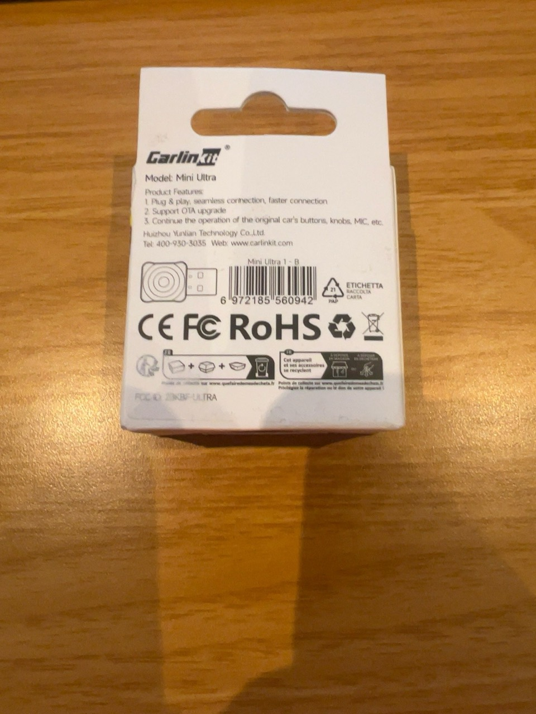
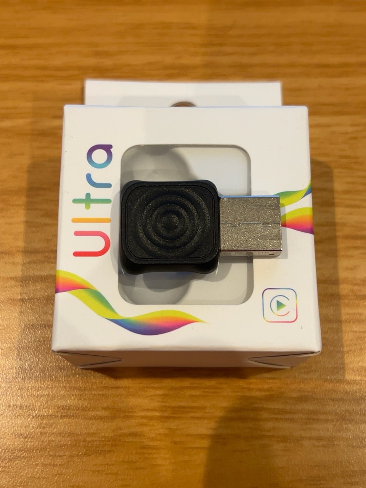

# Carlinkit MINI Ultra 1-B — October relay source experiment

**Experimental source only. Not a firmware package or a general compatibility claim.** This directory contains the v0.4 relay source and offline host regressions. It contains no adapter firmware, stock rollback archive, patched executable, or device uploader. The existing firmware ZIPs in this repository are unchanged.

The implementation reads HU canvas geometry dynamically, and the host geometry tests exercise several synthetic canvas sizes. The binary hooks and ABI are tied to the exact October `sdDongle` build below. Dynamic geometry does not make the binary compatible with other adapter firmware, hardware revisions, or head units.

## Observed sample and pinned software baseline

The owner reports that the purchased adapter was labeled **Mini Ultra 1-B** and, after the October OTA, reported the following sample values. These are observed values for that one adapter, not defaults or a compatibility guarantee:

| Field | Observed sample |
| --- | --- |
| Platform | `AX1800M` |
| Custom | `suding` |
| Product model | `v851se-yunlian-cp` |
| System version | `202603120956CA` |
| Protocol version | `20261008165747` |
| OTA catalog label | `ax_202610081657` |
| Stock OTA TAR size | 1,812,992 bytes |
| Stock OTA TAR SHA-256 | `13ca438ad4db00bbac0fa4650419df110bf17611a69525409261318a8bbade86` |

The stock TAR and vendor executable are not redistributed here. To reproduce analysis or a target build, obtain the exact `ax_202610081657` stock archive through a lawful source and verify its SHA-256 before use. The public source build and host tests below do not require vendor firmware. No firmware-independence claim is made.

Owner-provided purchase listing (reference only; not evidence of internal hardware): [Amazon.de](https://www.amazon.de/dp/B0F67CP9ZD).

The manufacturer lists the product as `CPC200-Mini Ultra1` on its [official Mini Ultra1 page](https://www.carlinkit.com/ultra1). Public [CatPlay Mini Ultra documentation](https://github.com/catplay-labs/catplay-firmware/blob/master/docs/Carlinkit%20Mini%20Ultra.md) describes an AX1800M revision and warns that the Mini Ultra name has also been used for different hardware. The product name alone does not identify a board revision or installed software. The public documentation is contextual hardware information, not evidence that CatPlay or this relay was tested on other revisions.



User supplied this packaging photo for publication with permission. Rights remain with the owner; no open license is granted. Its label/EAN identify the package, not the exact internal board.



Owner supplied this original photo and permitted publication. Rights remain with the owner; no open license is granted. It documents the package and dongle appearance; the package label/EAN does not prove the exact internal board.

## Reported head-unit test and known issue

On one owner-reported Skoda MHI2 / `MHI2_ER_SKG13_P4526_MU1440` setup, CarPlay video/configuration, navigation symbols, and zoom were observed. One menu exit did not immediately disconnect. v0.4 corrects a source-level teardown classification error: the stock callback provides a `CFDictionary`, not a stream array. This source correction does not prove the cause of the menu-exit behavior or qualify it. Spontaneous keepalive disconnects remain unresolved. This is one owner-reported test, not independent validation or support for every vehicle, adapter, or firmware variant.

## Build and offline tests

Requirements: Zig **0.14.1**, Python 3, a POSIX C compiler (`cc`, `clang`, or `gcc`), and pthreads. Run on Linux or macOS, or in a POSIX environment such as WSL. No vendor firmware input is required for these source and host checks.

```sh
ZIG=/path/to/zig-0.14.1 HOST_CC=cc python3 build.py
```

The script checks the Zig version, cross-compiles `src/relay.c` for MIPS32r2 into `build/libSdHOct.so`, then builds and runs `tests/relay_test.c` and `tests/geometry_test.c` on the host. Set `ZIG` to the Zig 0.14.1 executable and `HOST_CC` to the POSIX C compiler if they are not available under those names. Build outputs are kept under `build/`.

The tests cover source-level socket framing and cancellation, teardown classification, concurrent relay lifecycle seams, and geometry handling with mocks. They do not exercise a complete adapter worker session, target loading, phone negotiation, rendering, audio, or vehicle behavior. A successful host build is not hardware qualification.

## Provenance and license

The v0.4 source builds on the supplied MIT-licensed v0.2 source package. Some ABI declarations and geometry/AVCC helper lineage derive from OMKE's [wireless-carplay-virtual-cockpit source](https://github.com/OMKE/wireless-carplay-virtual-cockpit), reference commit `321191526ef26f98df87d85cd35d7597e5940ff1`; the MIT notice and attribution remain in [LICENSE](LICENSE) and [THIRD_PARTY_NOTICES.md](THIRD_PARTY_NOTICES.md). Project-authored v0.3 changes added initial SETUP acceptance, independent cockpit teardown, and cancellation lifetime handling. v0.4 corrects the stock teardown ABI classification. The October ABI and hook addresses were developed using the exact vendor executable identified above; this is not a clean-room reverse-engineering claim. Vendor firmware is not included or relicensed.

Included source, tests, build script, MIT notice, and photo hashes are listed in [SOURCE-MANIFEST.sha256](SOURCE-MANIFEST.sha256).
